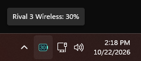
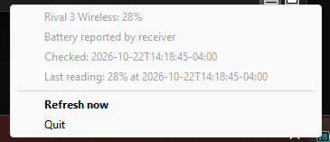

# rival-batt

A small Windows and Debian tray utility for **SteelSeries Rival 3 Wireless, first generation**, using its **2.4 GHz USB receiver** (`1038:1830`). It queries the battery directly; SteelSeries GG is not required. Bluetooth and other mouse models are not supported by this version.

The tray icon shows the percentage, turns red at 20% or below, and refreshes every five minutes. Right-click it for details, **Refresh now**, or **Quit**. A question mark means the reading is unavailable; the previous successful reading is listed separately with its timestamp. There is no telemetry, network access, browser runtime, or background service. It sends only the battery query, and does not change mouse settings.

## Screenshots

Battery percentage in the Windows system tray:



Tray menu with battery status, timestamps, and refresh controls:



## Get the source

Clone the repository, then run the commands for your platform from its directory:

```sh
git clone https://github.com/kbmod/rival-batt.git
cd rival-batt
```

You can also use GitHub's **Code → Download ZIP** and extract it. This repository contains source code; build the executable or Debian package using the instructions below.

## Windows

Install Python 3.10 or newer with Python available on PATH, then run in PowerShell:

```powershell
python -m venv .venv
.\.venv\Scripts\python.exe -m pip install -r requirements.txt
.\.venv\Scripts\pythonw.exe rival_batt.py
```

Look in the tray overflow arrow if the icon is hidden. For a terminal battery reading, run `.\.venv\Scripts\python.exe rival_batt.py --once`.

### Build a standalone executable

```powershell
.\build-windows.ps1
```

The script creates `dist\rival-batt.exe` using PyInstaller. That executable runs without a separate Python installation. It is unsigned; the build script does not create a release ZIP.

Optional startup: press Win+R, enter `shell:startup`, and place a **shortcut** to your built executable there. Keep the executable in a permanent folder. Remove that shortcut to stop launching at login. Quit through the tray menu before deleting the app.

## Debian 12 / 13

Install directly from the source directory:

```sh
sh linux/install.sh
```

The script installs Debian dependencies, the app under `/usr/local`, a desktop launcher, and a device-access rule. Reconnect the USB receiver so the rule takes effect, then launch **rival-batt** from your applications menu, or run `rival-batt`. Run the app as your normal desktop user, without sudo.

The package uses Debian's Python, HIDAPI, Pillow, PyGObject, and AppIndicator libraries. GNOME needs a tray extension such as Debian's `gnome-shell-extension-appindicator`; enable it in Extensions. Other desktops need an indicator-compatible tray. CLI mode works without a desktop:

```sh
rival-batt --once
rival-batt --json
rival-batt --interval 60
```

To start at login, copy `/usr/local/share/applications/rival-batt.desktop` to `~/.config/autostart/` (create the folder first). Uninstall this source installation with `sh linux/uninstall.sh`.

### Build a Debian package instead

As an alternative to `linux/install.sh`, build and install an architecture-independent package:

```sh
python3 build-debian.py
sudo apt install ../rival-batt_0.1.0_all.deb
```

The build script writes the package to the parent directory. With this installation method, the desktop launcher is `/usr/share/applications/rival-batt.desktop`. Uninstall with `sudo apt remove rival-batt` and remove your autostart copy if you made one. Choose one installation method to avoid duplicate installations.

## Source and development

Python 3.10 or newer is required. After setting up the Windows environment above, run the tests with:

```powershell
.\.venv\Scripts\python.exe -m unittest discover -s tests -v
```

On Debian, run `python3 -m unittest discover -s tests -v`. The Windows executable uses a GUI subsystem, so use `python.exe rival_batt.py --once` or `--json` for terminal output. `build-debian.py` uses Python's standard library and can also build the Debian package on Windows.

## Troubleshooting and limits

* Wake the mouse and choose Refresh now if it does not respond. A receiver can report a cached battery value when the mouse sleeps; the app displays what it reports and cannot guarantee freshness inside the receiver.
* If the receiver cannot be opened, close other mouse-monitoring programs and try again. Debian permissions require a logged-in local desktop session and reconnecting the receiver after installing the udev rule.
* Battery percentages are the device's estimate; AAA battery chemistry can affect accuracy.
* A missing receiver is retried at the next refresh. Only one tray instance runs per user. No low-battery popup notifications are included.
* Hardware query and tray startup were verified on Windows with the connected Rival 3 Wireless. Debian package contents were checked, but Debian installation, permissions and GUI behavior have **not been runtime-tested**.

## Protocol reference and licenses

The USB interface and battery command were checked against [rivalcfg's Rival 3 Wireless profile](https://github.com/flozz/rivalcfg/blob/master/rivalcfg/devices/rival3_wireless.py) and [HID transport](https://github.com/flozz/rivalcfg/blob/master/rivalcfg/usbhid.py). This is an independent implementation. Dependencies retain their own licenses; include their required notices when distributing a bundled executable. This project is MIT licensed; see LICENSE.
